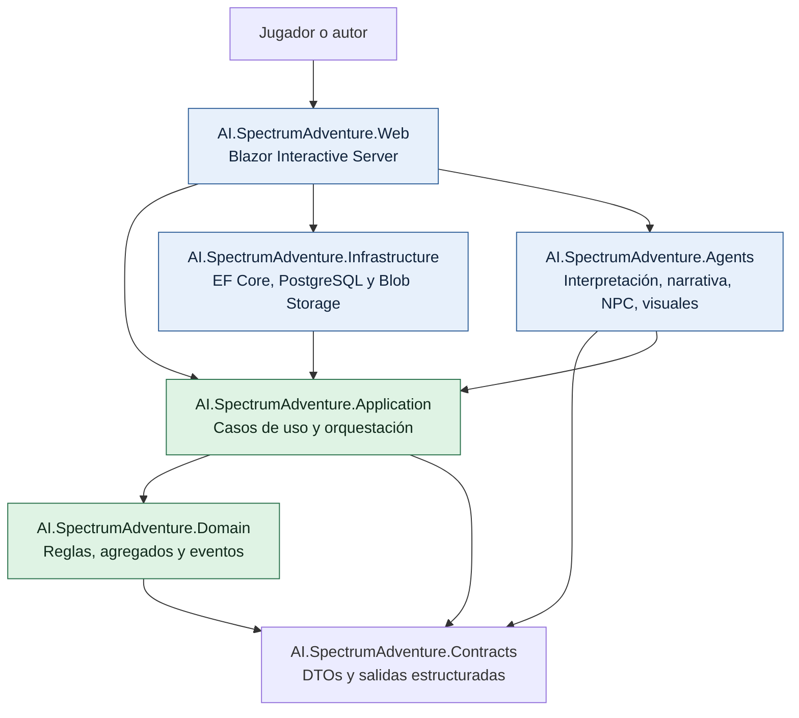
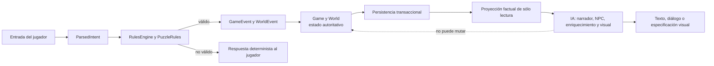
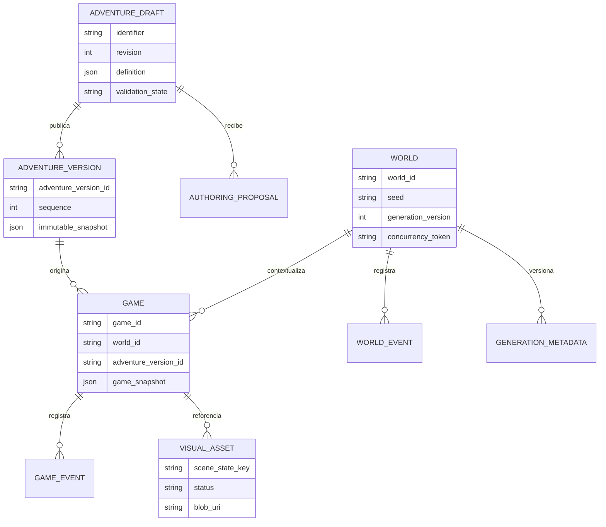
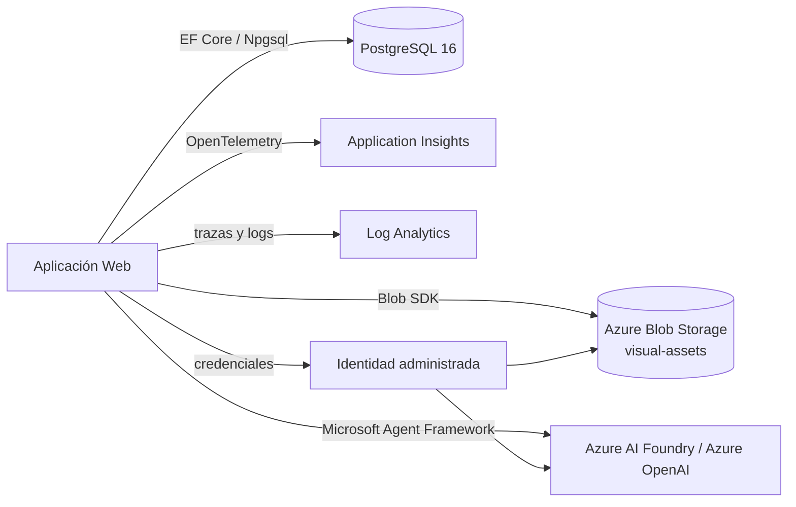
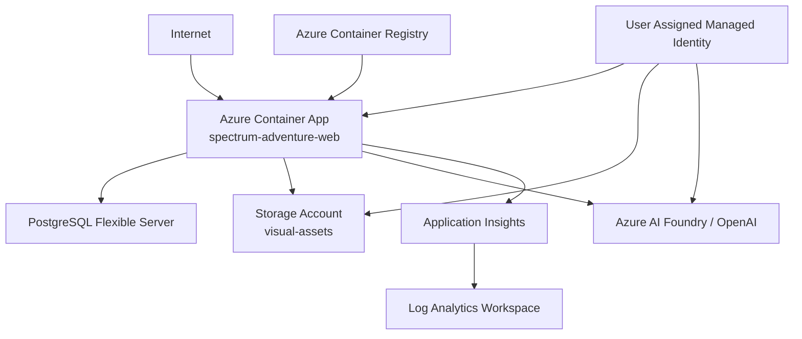

# Arquitectura de la solución

## 1. Decisión principal: monolito modular, no microservicios prematuros

La aplicación se despliega como una única aplicación ASP.NET Core, pero se organiza por responsabilidades en proyectos independientes. Esta elección reduce la complejidad operativa sin mezclar reglas de negocio, acceso a datos, UI e IA.

El diseño deja puntos de extracción claros: los agentes y la canalización de imágenes dependen de abstracciones de Application, por lo que podrían migrar a un worker independiente si la carga lo justificara. Hoy no existe una necesidad que compense introducir mensajería distribuida, Dapr o despliegues por agente.

### Dirección de dependencias

- **Domain**: C# puro. No conoce EF Core, Azure, ASP.NET, Blazor ni Agent Framework.
- **Application**: define casos de uso y puertos (`IGameRepository`, `INarratorAgent`, `IWorldRepository`, etc.). Coordina, pero no conoce implementaciones técnicas.
- **Infrastructure**: adapta esos puertos a EF Core, PostgreSQL y Blob Storage.
- **Agents**: adapta puertos de IA a Microsoft Agent Framework y valida sus respuestas estructuradas.
- **Web**: es el composition root. Registra dependencias, hospeda Blazor y aplica migraciones al arranque.
- **Contracts**: transporta datos tipados entre capas sin filtrar modelos de infraestructura hacia el dominio.

El resultado es que una regla de juego se puede probar sin red, base de datos o modelo generativo, y que un fallo de IA no convierte el juego en una aplicación inconsistente.

## 2. Autoridad del estado

La frontera más importante del sistema no es tecnológica: es la frontera de autoridad. `Game` mantiene el estado por jugador; `World` mantiene el estado compartido y estructural del mundo. Ambos cambian sólo mediante eventos y reglas deterministas.

La IA tiene cuatro responsabilidades concretas:

| Componente | Entrada | Salida | Límite de seguridad |
| --- | --- | --- | --- |
| Intérprete de intención | Texto libre | `ParsedIntent` | No decide si la acción es posible. |
| Narrador | Resultado validado y escena factual | `NarrationResult` | No inventa estado ni persiste cambios. |
| Agente NPC | Personalidad, conocimiento permitido e historial acotado | `NpcResponse` | No revela claves fuera de `KnowledgeBoundary`. |
| Director visual | Escena persistida y restricciones retro | `VisualSceneSpec` | No es la representación autoritativa de la escena. |
| Propuestas de autoría | Contexto acotado del borrador | `AuthoringProposal` | El autor revisa y acepta; nunca publica automáticamente. |

Las salidas se deserializan como contratos tipados y se validan. El narrador tiene un fallback determinista; las imágenes y el enriquecimiento son opcionales. Esta combinación evita que una respuesta incorrecta o una indisponibilidad del proveedor cambien la realidad del juego.

## 3. Datos, agregados y consistencia

Aspectos que merece la pena explicar:

- Un borrador es mutable y tiene revisión para detectar escrituras concurrentes.
- Una versión publicada es un snapshot inmutable. Las partidas existentes continúan enlazadas a su versión de origen.
- El mundo tiene una semilla y una versión de generación persistidas. La estructura nueva se deriva de ambas, pero el sistema nunca regenera un mundo persistido para sobrescribir sus eventos.
- Las expansiones usan una `GenerationKey` única. Dos réplicas que intenten abrir la misma frontera convergen en un único resultado persistido.
- Las actualizaciones que afectan a `World` y `Game` se guardan en una transacción de PostgreSQL.

## 4. Persistencia y recursos externos

PostgreSQL conserva la verdad del producto: partidas, catálogo, borradores, versiones, mundo, eventos y metadatos visuales. Blob Storage sólo contiene bytes de recursos visuales generados. La separación evita convertir una imagen o una descripción en una fuente accidental de verdad.

## 5. Despliegue en Azure

La infraestructura Bicep provisiona una Container App, PostgreSQL Flexible Server, Storage Account, Application Insights, Log Analytics, Azure Container Registry, identidad administrada y, opcionalmente, Azure AI Foundry. La Container App expone HTTPS en el puerto 8080 y escala entre una y dos réplicas.

En producción la configuración llega como variables de entorno y secretos de Container Apps. En local, Aspire orquesta PostgreSQL y Azurite; los secretos de Azure AI se suministran mediante user-secrets, nunca desde configuración versionada.

## 6. Observabilidad y degradación controlada

OpenTelemetry registra actividades para acciones de juego, generación de mundo e invocaciones de agentes. La telemetría debe incluir resultado, duración y tipo de fallo, evitando prompts, definiciones completas de borradores y bytes de imágenes.

La estrategia de resiliencia es deliberada:

| Dependencia degradada | Comportamiento del producto |
| --- | --- |
| Narrador o contrato de salida inválido | Se usa una descripción determinista. |
| Imagen o procesamiento retro | La narrativa continúa; el recurso visual queda como fallido. |
| Enriquecimiento de mundo | La estructura ya persistida permanece explorable. |
| Conflicto de expansión | Se recupera la expansión ganadora mediante clave única. |
| Validación de reglas fallida | No hay mutación y se entrega feedback coherente. |

Esta matriz es un mensaje técnico importante: la IA mejora la experiencia, pero no es un punto único de fallo para el bucle principal.