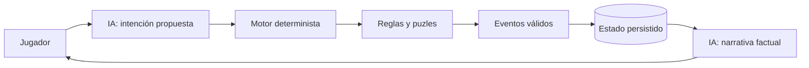

# Recurso 03: Autoridad del estado

## Diagrama

## Mensaje oral

"La IA aparece dos veces, pero ninguna es autoridad: primero sugiere una intención y después transforma hechos ya confirmados en lenguaje. La única ruta hacia el estado pasa por el motor y sus reglas."

## Referencia ampliada

- [Diagrama de autoridad](../architecture.md)