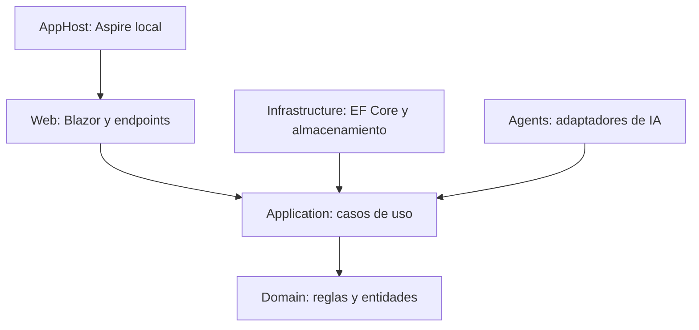

# Recurso 04: Capas modulares

## Diagrama

## Mensaje oral

"No hemos convertido cada carpeta en un microservicio. Son límites de código dentro de un despliegue. El dominio no depende de EF Core, Azure ni del proveedor de modelos; por eso podemos probar reglas y sustituir adaptadores sin mover la lógica central."

## Referencia ampliada

- [Arquitectura modular](../architecture.md)