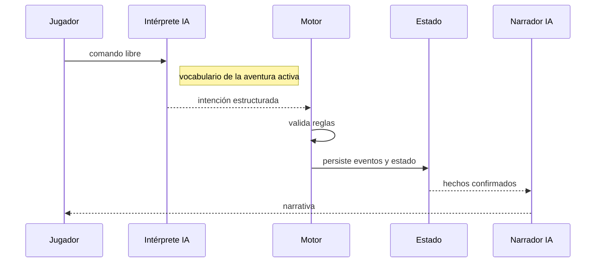

# Recurso 05: Turno determinista

## Secuencia

## Mensaje oral

"Un turno no es texto que modifica una base de datos. El intérprete resuelve las expresiones del jugador con el vocabulario de la aventura y produce una intención; después llegan validación, eventos y persistencia. La narración ocurre al final, a partir de hechos."

## Referencia ampliada

- [Flujo de acción normal](../runtime-flows.md)