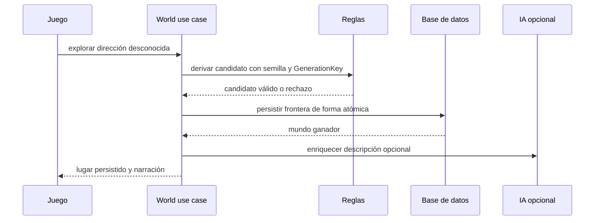

# Recurso 07: Exploración dinámica

## Secuencia

## Mensaje oral

"Primero existe un lugar válido y persistido; después puede existir una descripción enriquecida. La `GenerationKey` hace idempotente la exploración concurrente: dos solicitudes de la misma frontera reutilizan el mismo resultado."

## Referencia ampliada

- [Mundo dinámico](../runtime-flows.md)