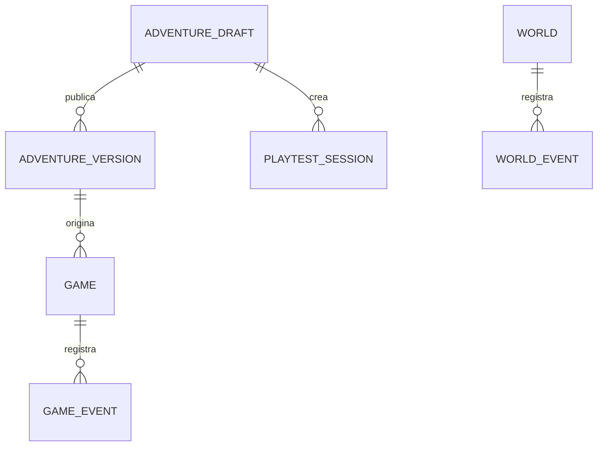

# Recurso 08: Modelo y concurrencia

## Modelo mínimo

## Mensaje oral

"Los borradores son mutables y usan revisión optimista. Las versiones publicadas son snapshots inmutables. Un juego guarda su versión de origen, de modo que publicar una aventura nueva no reescribe partidas activas."

## Punto de atención

Explica que las inserciones únicas y las transacciones resuelven la carrera de exploración sin depender de memoria local de una réplica.

## Referencia ampliada

- [Modelo de datos](../architecture.md)