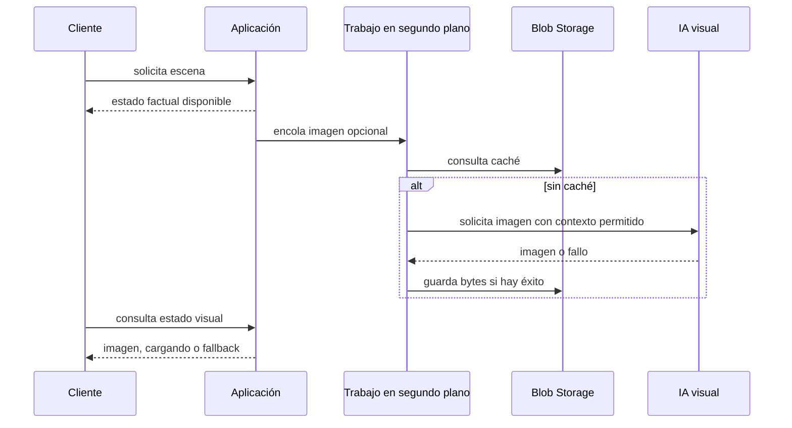

# Recurso 09: Pipeline visual

## Secuencia

## Mensaje oral

"El jugador nunca espera a una imagen para recibir el resultado del turno. Blob Storage almacena bytes, no verdad del juego. Si el pipeline falla, seguimos mostrando la localización y sus hechos."

## Referencia ampliada

- [Pipeline visual asíncrono](../runtime-flows.md)