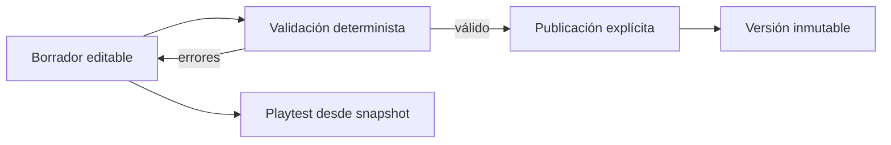

# Recurso 10: Autoría y publicación

## Flujo

## Mensaje oral

"El editor ayuda a crear mundos, pero no publica contenido automáticamente. Incluso una propuesta de IA requiere revisión y aceptación humana, pasa por el validador y sólo después puede formar parte del borrador."

## Referencias

- [Flujo de autoría](../runtime-flows.md)
- [Manual de autoría](../../adventures/adventure-authoring-guide.md)