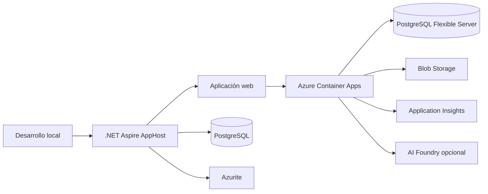

# Recurso 11: Operación

## Topología

## Mensaje oral

"Aspire reproduce localmente las dependencias que importan y pasa configuración a la aplicación. En Azure desplegamos una sola aplicación web con identidad administrada, almacenamiento y telemetría. La observabilidad registra resultados y duración, no prompts ni cuerpos de borrador."

## Referencias

- [Despliegue](../architecture.md)
- [Guion de demostración](../demo-script.md)