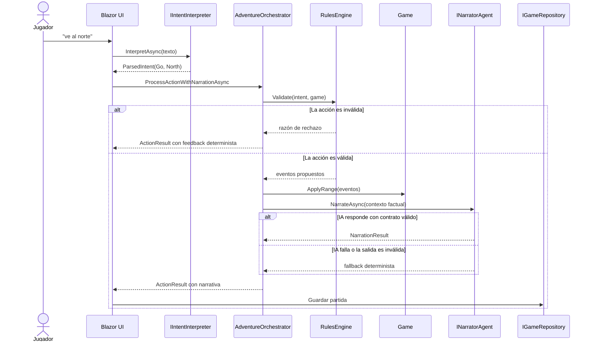
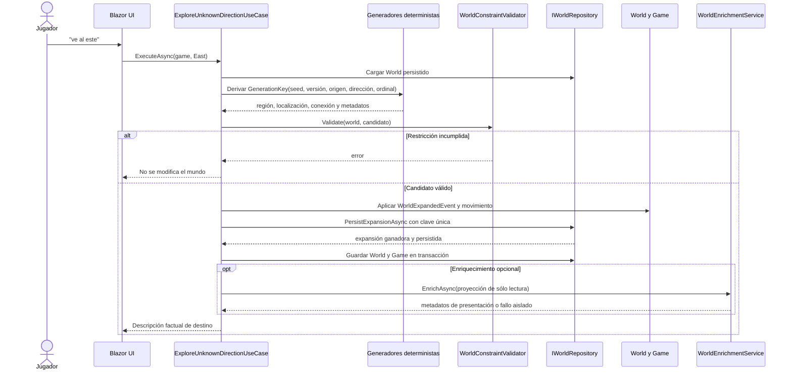
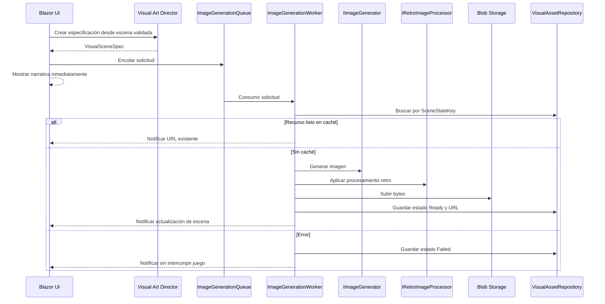
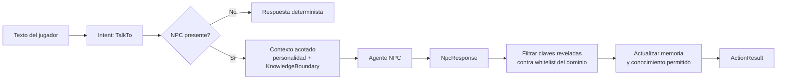
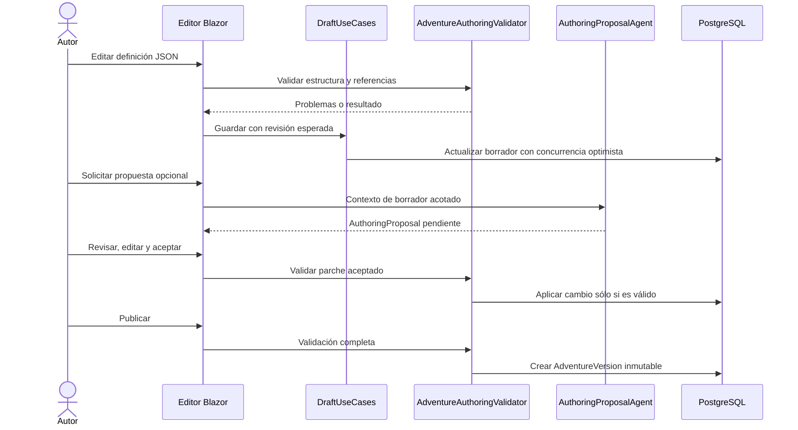

# Flujos de ejecución

## 1. Acción normal del jugador

La UI no entrega el texto directamente a un modelo narrativo. Primero lo interpreta como una intención estructurada y el motor comprueba esa intención contra el estado actual.

La cualidad esencial del orden es que, cuando el narrador recibe contexto, los cambios ya fueron validados y aplicados. Puede describirlos, pero no decidirlos ni revertirlos.

## 2. Exploración de una frontera desconocida

La exploración procedimental no pide a un modelo que invente un lugar y lo haga verdadero. Genera estructura de forma determinista, valida restricciones, persiste y sólo entonces permite el enriquecimiento narrativo.

La `GenerationKey` hace idempotente la expansión. Ante competencia, la restricción única de base de datos sustituye un lock local que no funcionaría con varias réplicas.

## 3. Canalización visual asíncrona

La imagen no está en el camino crítico de una acción. Sólo se solicita después de detectar un cambio de escena y se procesa en segundo plano con caché por `SceneStateKey`.

El trabajador registra la excepción y marca el recurso como fallido. No propaga el error al turno del jugador.

## 4. Conversación con NPC

El NPC recibe un subconjunto controlado del mundo: personalidad, objetivos, relaciones, memoria limitada y una lista de conocimiento permitido. Incluso después de la respuesta, el orquestador filtra las claves reveladas frente a la lista del dominio.

## 5. Ciclo de autoría

La autoría tiene el mismo principio de autoridad que el juego: una propuesta de IA es un artefacto revisable, no una escritura de datos.

Una partida se vincula con la versión publicada de la que nació. Restaurar una versión crea un borrador nuevo; nunca modifica el snapshot histórico.